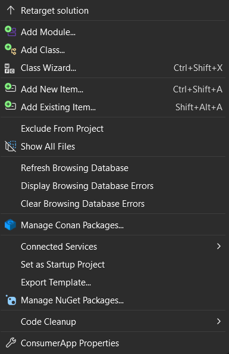
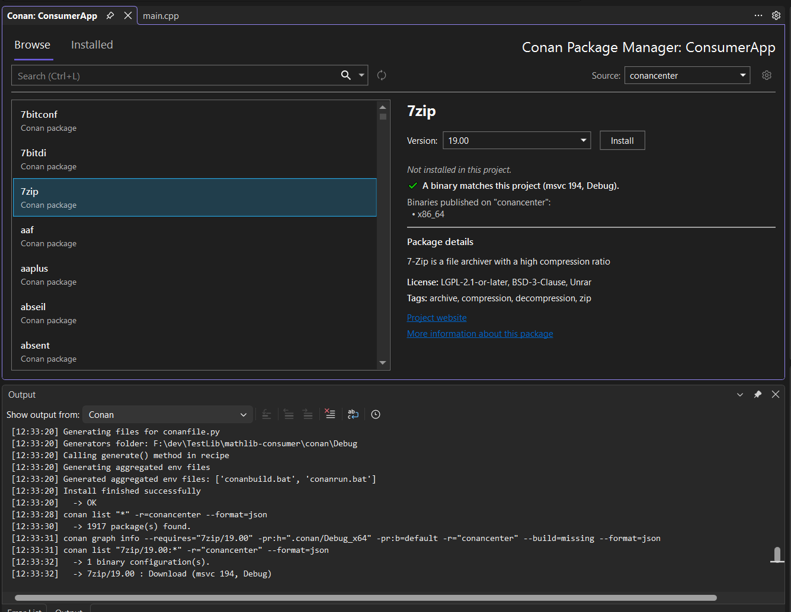
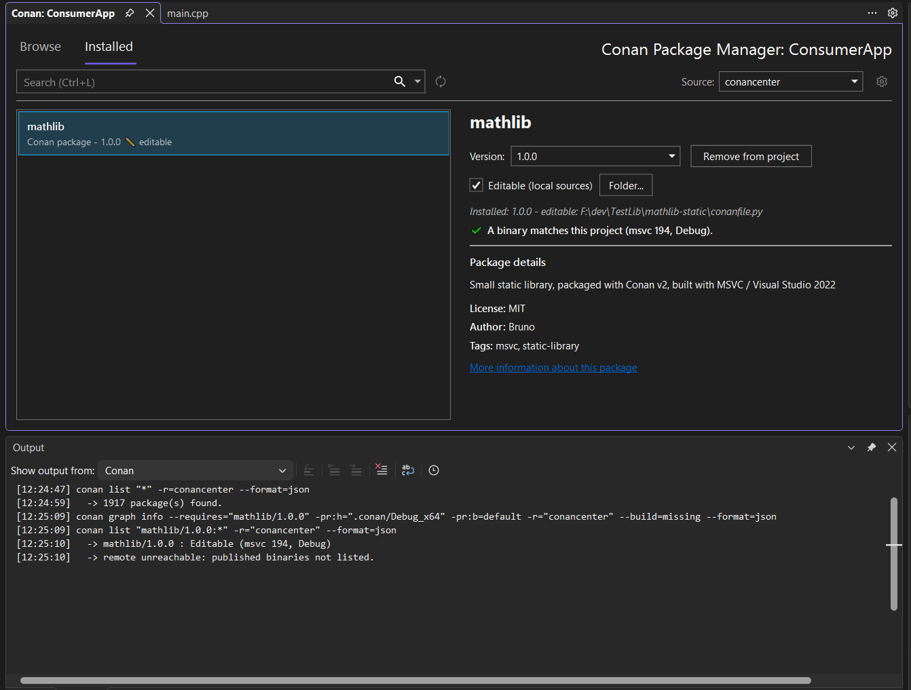
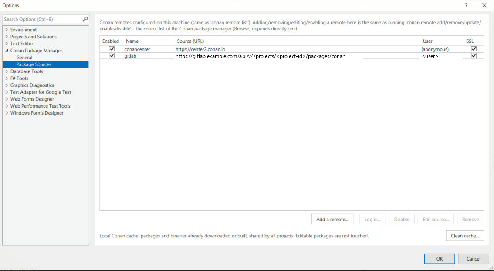
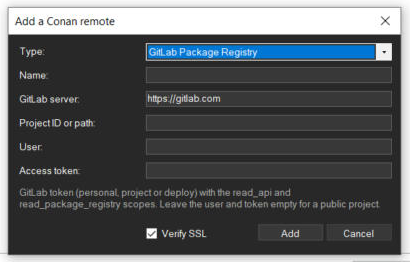

# Conan Visual Studio Extension for Conan 2


**English** | [Français](README.fr.md)

Conan, the C and C++ package manager, directly inside Visual Studio. Browse the libraries of
your Conan remotes, check that they fit your project, install them, work on their sources
and debug them - without leaving the IDE.

- 🔧 **Conan 2 only** (2.0 and above).
- 💻 **Visual Studio 2022 and 2026**, C++ (MSBuild / `.vcxproj`) projects.
- 🌍 **English and French:** the extension follows the language of the Visual Studio UI.
- 📦 Works with ConanCenter, Artifactory, a Conan server and **GitLab Package Registry**.

## Table of contents

1. [Installation](#1-installation)
2. [First steps](#2-first-steps)
3. [Browsing and installing libraries](#3-browsing-and-installing-libraries)
4. [Compatibility check before installing](#4-compatibility-check-before-installing)
5. [Removing a library from a project](#5-removing-a-library-from-a-project)
6. [Editing and debugging a library (editable mode)](#6-editing-and-debugging-a-library-editable-mode)
7. [Remotes (package sources)](#7-remotes-package-sources)
8. [Adding a remote, including GitLab](#8-adding-a-remote-including-gitlab)
9. [Working offline](#9-working-offline)
10. [How the extension integrates with your project](#10-how-the-extension-integrates-with-your-project)
11. [Output pane and troubleshooting](#11-output-pane-and-troubleshooting)
12. [Settings](#12-settings)
13. [Packaging a library](#13-packaging-a-library)
14. [Building the extension and releases](#14-building-the-extension-and-releases)

## 1. Installation

**Prerequisites**

- Visual Studio 2022 or later with the *Desktop development with C++* workload.
- [Conan 2](https://docs.conan.io/2/installation.html) installed and available on your
  `PATH` (`conan --version` must work in a terminal). If it is installed somewhere else, you
  can point the extension at it, see [Settings](#12-settings).

**Install the extension**

- From Visual Studio: **Extensions > Manage Extensions**, search for *Conan*, **Download**,
  then restart Visual Studio.
- From a release: download `conan-vs-extension.vsix` from the
  [GitHub releases](https://github.com/gandybruno/conan-vs-extension/releases), close Visual
  Studio and double-click the file.
- From source: see [Building the extension](#13-building-the-extension-and-releases).

There is **nothing to configure** if `conan` is on your `PATH`: the extension uses it and
selects **conancenter** as the default package source.

## 2. First steps

Open a C++ solution, then right-click a project in Solution Explorer - or use the **Project**
menu - and choose **Manage Conan Packages...**.



This opens a document window dedicated to that project, with a **Browse** tab (everything the
selected source offers) and an **Installed** tab (what the project already uses).

> The command also appears in the **Project** menu when a C++ project is selected. The
> **Refresh Browsing Database** entry just above it is Visual Studio's own command (see
> [IntelliSense](#intellisense)).

## 3. Browsing and installing libraries



- **Source** (top right): the Conan remote the list comes from. Remotes are the ones
  configured in Conan (`conan remote list`). The ⚙ button opens the extension settings and the
  🔄 button refreshes the list.
- **Search box** (Ctrl+L): the list filters as you type. Enter, or the magnifying glass, keeps
  the term in a *recent searches* drop-down.
- **Details panel**: version picker, description, license, author, topics, homepage and the
  [compatibility check](#4-compatibility-check-before-installing).
- **Install**: adds the library to the project and runs `conan install` straight away, so the
  next build already has everything it needs. A progress overlay is shown (Conan may have to
  compile a missing binary, which can take minutes) and the full command output scrolls in the
  **Conan** pane of the Output window.

The first time, the extension creates `conanfile.py` and `conandata.yml` next to the project
file, then keeps `conandata.yml` up to date as you add or remove libraries.

## 4. Compatibility check before installing

When you select a library/version, the extension asks Conan (`conan graph info`) whether the
project's profile - compiler version, build type, runtime, C++ standard - can use it, **without
installing or building anything**:

| Message | Meaning |
|---|---|
| ✔ *A binary matches this project (msvc 194, Debug).* | A prebuilt binary exists (in the cache or on the remote). |
| ⚠ *No prebuilt binary... will be built from the sources included in the package.* | Conan will compile it; the sources travel with the recipe (works offline). |
| ⚠ *... the recipe downloads its sources from the internet.* | Conan will compile it; a network connection is required for the sources. |
| ⛔ *Incompatible with this project: ...* | The recipe refuses this configuration, or there is no binary **and** no source. **Install is disabled** and the reason is shown. |
| *Compatibility could not be verified.* | Conan could not answer (offline, error). Install stays enabled. |

Below the message, the **binaries published on the remote** for that version are listed (compiler,
build type, runtime, architecture - Windows ones only), so you can see at a glance which
configurations are available. Header-only libraries are shown as compiler-independent.

> The `compiler.version` of the generated profile comes from the MSVC toolset your project
> really uses (for example MSVC 14.44 → `194`), so it matches the compiler that will build the
> library. When the project's platform toolset differs from the one your Visual Studio
> provides by default, a note is written to the Conan Output pane.

## 5. Removing a library from a project



The **Installed** tab lists the dependencies of the current project, read from its
`conandata.yml` - even libraries the selected source does not know (a local or editable
package, a package from another remote).

**Remove from project** deletes the dependency from `conandata.yml` and re-runs
`conan install`. The package **stays in the Conan cache**, so your other projects are not
affected. To empty the cache see [Cleaning the cache](#cleaning-the-local-cache).

## 6. Editing and debugging a library (editable mode)

Conan's *editable packages* let a project use the sources of a library from a local folder
instead of the package in the cache, so you can modify the library and debug into it.

1. In the **Installed** tab select the library.
2. Check **Editable (local sources)** and choose the folder that contains the library's
   `conanfile.py`.
3. The extension runs `conan editable add` and `conan install`; the project now builds against
   your local sources. The folder is shown under the name, a ✎ marks editable packages in the
   list and **Folder...** changes it.
4. Uncheck the box to go back to the regular package.

Requirements (Conan's, not the extension's):

- the recipe must define `layout()`;
- the library must have been built once in its own folder (`conan build .`) so its generated
  files exist, in the same configuration as your project (Debug/Release...).

Editable mode is stored in the Conan home, so it applies to **every** project on the machine
that uses that `name/version`. The state is read from Conan each time it is displayed.

## 7. Remotes (package sources)

**Tools > Options > Conan Package Manager > Package Sources** (or the ⚙ button of the package
manager) is a NuGet-style grid of the remotes configured on the machine - the same list as
`conan remote list`.



| Button | Equivalent command |
|---|---|
| **Add a remote...** | `conan remote add` (see [below](#8-adding-a-remote-including-gitlab)) |
| **Log in... / Log out** | `conan remote login` / `conan remote logout` |
| **Enable / Disable** | `conan remote enable` / `conan remote disable` |
| **Edit source...** | `conan remote update` |
| **Remove** | `conan remote remove` (only the configuration, not the packages) |

The **User** column shows who is authenticated on each remote. Passwords are handed to `conan`
through its environment, never on the command line. The **Source** drop-down of the package
manager follows the changes made here.

### Cleaning the local cache

**Clean cache...** (bottom right of the page) runs `conan remove "*" -c` after a confirmation:
every package and binary downloaded or built so far, for all projects, is deleted and will be
downloaded or rebuilt on the next `conan install`. Editable packages are not touched.

## 8. Adding a remote, including GitLab

Click **Add a remote...**.



**Conan remote (URL)** - Artifactory, a Conan server...: give a *name* and the *URL*.

**GitLab Package Registry** - fill in:

| Field | Value |
|---|---|
| Name | Any name, for example `gitlab` |
| GitLab server | `https://gitlab.com` or your own server |
| Project ID or path | The numeric project ID (*Settings > General*) or `group/project` |
| User | Your GitLab user name (private project) |
| Access token | A personal, project or deploy token with the **`read_api`** and **`read_package_registry`** scopes (private project) |

The dialog builds the Conan v2 URL
`<server>/api/v4/projects/<id>/packages/conan` for you and, when a user and a token are given,
logs you in. Leave both empty for a public project.

The same thing from a terminal:

```
conan remote add gitlab https://gitlab.com/api/v4/projects/<project-id>/packages/conan
conan remote login gitlab <username> -p <token>
```

GitLab's Conan endpoint does not support a bare wildcard search, so for GitLab remotes the
extension also queries GitLab's
[packages API](https://docs.gitlab.com/ee/api/packages.html#for-a-project) to list the
library names; the token is remembered per remote for this purpose.

To publish a package to that remote: `conan upload "<name>/<version>" -r=gitlab`.

## 9. Working offline

If the selected remote cannot be reached, the list falls back to the **local Conan cache**
(packages you already downloaded) and a banner says so. Installing a library whose recipe and
binary are in the cache works without a connection. The compatibility check simply reports
that it could not be verified and never blocks the installation in that case.

## 10. How the extension integrates with your project

Files written next to the `.vcxproj`:

| File | Purpose |
|---|---|
| `conandata.yml` | The list of dependencies (`requirements:`). Edited by the extension. |
| `conanfile.py` | A generated recipe that installs what `conandata.yml` lists and generates the MSBuild property sheets. |
| `.conan/<Config>_<Platform>` | One Conan profile per build configuration, generated from the project (arch, build type, compiler version, runtime, C++ standard). |
| `.conan/conan_install.bat` | Pre-build step that re-runs `conan install` when something changed. |
| `conan/**/*.props` | The property sheets Conan generates; imported by the project so include and library paths are set. |

Both `conanfile.py` and `conandata.yml` start with a comment guard: if you remove it, the
extension stops modifying the file and you are free to edit it by hand.

Automatic behaviors:

- `conan install` runs proactively when a solution is opened, a project is added, or the
  active configuration/profile changes - and only when something changed since the last
  successful install of that configuration (dependencies, recipe, profile, or a package
  missing from the Conan cache). Installs are serialized so two of them never race on
  the Conan cache.
- If you start a **Build** while Conan is installing, the build is postponed and what you
  asked for (Build, Rebuild, a single project, F5...) is restarted automatically once Conan has
  finished.
- A missing default Conan profile is created for you (`conan profile detect`).
- Every `conan` call is bounded by a timeout so a hung command never freezes the IDE.
  `conan install` has no time limit - building a large library takes as long as it takes -
  but it can be stopped with **Cancel**, and is stopped when it prints nothing for 15 minutes.
- A recipe left broken in the Conan cache is removed and the install retried once.

### IntelliSense

Empty `conandeps.props` files are created before the first `conan install` and imported
unconditionally, and when an install changes the generated property sheets the extension runs
**Project > Refresh Browsing Database** (*Rescan Solution*) for you, so `#include` lines of a
newly installed library are resolved without reloading the project.

## 11. Output pane and troubleshooting

Every `conan` command the extension runs - installs, lists, remote operations, recipe lookups,
compatibility checks - is logged in the **Conan** pane of the Output window (**View > Output**,
then choose *Conan* in *Show output from*). It shows itself as soon as something is logged,
and the output of `conan install`, including compiler output, streams live.

| Symptom | What to check |
|---|---|
| The window says Conan was not found | Install Conan 2, or set the path in **Tools > Options > Conan Package Manager > General**. |
| The list is empty / shows a banner | The remote is unreachable (offline, VPN, wrong URL): the cache is shown instead. |
| *Incompatible with this project* | Read the reason; pick another version, or change the project's configuration. |
| Binaries are rebuilt after changing toolset | Binaries are tied to `compiler.version`; check the toolset note in the Conan pane or publish a binary for your profile. |
| `#include` still underlined | Run **Project > Refresh Browsing Database** once; check the `conan/` folder exists. |
| GitLab login fails | The token needs `read_api` and `read_package_registry`; see the Conan pane for the exact error. |

## 12. Settings

**Tools > Options > Conan Package Manager > General**

- **Use System Conan** (default): uses `conan` from the `PATH`.
- **Executable Path**: a specific `conan.exe`. Unchecking *Use System Conan* lets you set it.

The selected source and the per-remote GitLab tokens are stored in
`%UserProfile%\.conan-vs-extension\plugin-settings.json` (plain text - treat it like any
credential file).

## 13. Packaging a library

A project that builds a static library or a DLL can itself become a Conan package, the way
`dotnet pack` turns a project into a NuGet package. Open **Manage Conan Packages...** on the
project: a **Package** tab appears next to **Browse** and **Installed** (it is not shown for
an application).

| Setting | Meaning |
|---|---|
| **Name** | Name of the package, in lowercase. Suggested from the project name. |
| **Version** | Stored in `version.txt`, next to the project. |
| **License** | Required, e.g. `MIT` or `Proprietary`. |
| **Description** | Optional. |
| **Public headers folder** | Relative to the project (default `include`). Its `*.h`, `*.hpp`... files are packaged with their subfolders. |
| **Include the debug symbols (.pdb)** | Packages the `.pdb` next to the binaries. |
| **Usable by projects built with a newer MSVC toolset** | A project built with a newer Visual Studio may use these binaries instead of asking for its own. Never the other way round. |
| **Configurations to package** | Debug and Release of the active platform by default. Both are needed: an MSVC Debug project cannot link a Release library. |

**Create package** saves the settings, then for each selected configuration builds it with
Visual Studio and runs `conan export-pkg`: the binaries Visual Studio just produced are
packaged as they are, Conan does not rebuild anything. All the configurations end up under
the same `name/version` in the **local Conan cache**, where the other projects of the machine
can install it from the **Browse** tab. The same action is available as **Create Conan
Package** in the **Project** menu and the project's context menu.

Nothing is uploaded. To share the package, run the command shown at the end:

```
conan upload <name>/<version> -r=<remote>
```

The package holds binaries only, like a NuGet package: a consumer cannot rebuild a
configuration that was not packaged.

A static library compiled with `/GL` (whole program optimization, the default of a Release
configuration) only suits the toolset that built it. The tab says so under the configuration,
and the toolset compatibility is not applied to it.

Files written next to the project:

| File | Content |
|---|---|
| `version.txt` | The version, alone on one line, so a release script or a CI job can bump it. |
| `conandata.yml` | The settings above (`package` section), next to the `requirements` of the project. |
| `conanfile.py` | The library recipe. It is the same for every project and reads the two files above. |

As for the other generated files, removing the two comment lines at the top of
`conanfile.py` hands it over to you: the extension no longer rewrites it and **Create
package** uses your recipe.

## 14. Building the extension and releases

Requirements: Visual Studio with the *Visual Studio extension development* workload.

```
git clone https://github.com/gandybruno/conan-vs-extension.git
cd conan-vs-extension
msbuild conan-vs-extension.csproj /t:Rebuild /p:Configuration=Release
```

The VSIX is produced in `bin\Release\conan-vs-extension.vsix`. Press F5 in Visual Studio to
debug it in the experimental instance.

**Branching (gitflow).** Work happens in `feature/*` branches merged into `develop`;
`master` only receives releases. Pushes to `develop` and pull requests are only *built* by
CI. A `v*` tag on a commit of `master` (matching the version in
`source.extension.vsixmanifest`) builds the VSIX and creates a draft GitHub release containing
it.

See [CHANGELOG.md](CHANGELOG.md) for the history and [LICENSE](LICENSE) (MIT).
